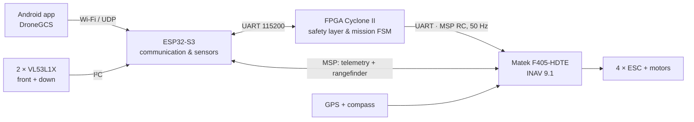

# Autonomous Drone with an FPGA Safety Layer

Final project, HIT (Holon Institute of Technology) - **Batel Ismailov & Amir Ben Lulu**

A quadcopter that is flown from an Android app and can run an autonomous waypoint mission with obstacle avoidance.
Every command to the flight controller passes through an **FPGA**, which acts as a hardware safety layer:
it is the only component that sends RC commands, it decides which commands are safe to forward, and it stops the command stream on link loss so the flight controller lands by itself.

- 🎬 **Project video:** [Photos_and_Videos/Project_Video.mp4](Photos_and_Videos/Project_Video.mp4)
- 📘 **Project book (Hebrew):** [Docs/Final_Project_Book.pdf](Docs/Final_Project_Book.pdf)
- 📊 **Project presentation (Hebrew):** [Docs/Project_Presentation.pdf](Docs/Project_Presentation.pdf)

---

## Architecture



| Layer | Responsibility |
|---|---|
| **Android app** | Pilot interface: virtual sticks, flight modes, mission settings, telemetry, emergency buttons |
| **ESP32-S3** | Wi-Fi access point, command parsing, reads both distance sensors, flight-phase logic (ground / air), telemetry from the flight controller |
| **FPGA** | Builds the RC packets for the flight controller, arbitration between app and mission, safety state machine (link loss, ESP loss, ABORT), compass gate for navigation modes, autonomous mission state machine |
| **Flight controller (INAV)** | Stabilization, altitude and position hold, waypoint navigation, failsafe landing |

## Main capabilities

- **Manual flight from the app** in ANGLE, ALTHOLD, POSHOLD and SURFACE (height above ground from the down sensor).
- **Hardware safety layer:** the FPGA is the only RC sender. When the app link or the ESP is lost it stops the RC stream, and INAV runs its failsafe landing. Motors are cut only by an explicit ABORT from the pilot.
- **Navigation gate:** POSHOLD / RTH / WP are allowed only with a verified compass. A frozen compass during navigation drops to ALTHOLD.
- **Autonomous mission:** flies an INAV waypoint mission. When the front sensor detects an obstacle the drone stops, climbs above it, crosses it, descends back to mission altitude and resumes the route. The mission starts only after 16 self-check conditions pass.
- **Ground / air detection** that combines the stick, throttle, down sensor and barometer, so the drone is not declared "on the ground" while in the air.

## Hardware

| Component | Model |
|---|---|
| Frame | F450 quadcopter frame with PDB |
| Motors / ESC / props | 4 × 2212 920KV, 4 × 30A ESC, 1045 props |
| Battery | LiPo 3S 4200 mAh |
| Flight controller | Matek F405-HDTE, INAV 9.1 |
| FPGA | Altera Cyclone II EP2C5T144C8, 50 MHz |
| Microcontroller | Freenove ESP32-S3 |
| Distance sensors | 2 × VL53L1X time-of-flight (front and down) |
| GPS / compass | NEO-M8N, IST8310 |

The full parts list and wiring are in [Docs/BOM.pdf](Docs/BOM.pdf) and [Docs/Wiring_Table.pdf](Docs/Wiring_Table.pdf).

## Repository structure

```
APP/                 Android ground-station app (Kotlin, Jetpack Compose)
  app/src/main/      app source code
  tests/             logic unit tests (run on a PC)
ESP32/               ESP32-S3 firmware (Arduino)
  drone_esp32.ino    main sketch
  config.h           pins, Wi-Fi, timing and thresholds
  lidar.h            VL53L1X sensors
  phase.h            ground / air detection
  surface.h          SURFACE mode
  mission.h          mission support
  msp.h, rfmsp.h     MSP communication with the flight controller
FPGA/                FPGA design (Verilog, Quartus II)
  drone_top.v        top module and RC arbitration
  flight_fsm.v       safety state machine
  mission_fsm.v      autonomous mission state machine
  cmd_parser.v       command parser for lines from the ESP
  msp_builder.v      MSP RC packet builder
  uart_rx.v, uart_tx.v
  sim/               testbenches (Verilator)
Docs/                project book, presentation, BOM, wiring table
Photos_and_Videos/   build photos and project video
```

## Getting started

### Connection
The ESP32 creates its own Wi-Fi network:

| | |
|---|---|
| SSID | `DroneAP` |
| Password | `drone1234` |
| ESP32 address | `192.168.4.1` |
| UDP port | `4210` |

Connect the phone to `DroneAP` and open the app.

### Android app
Open the `APP` folder in Android Studio and run it on a phone (Android 8.0 or later).
Built with Kotlin 2.1 and Jetpack Compose.

### ESP32-S3 firmware
1. Arduino IDE with the ESP32 board package.
2. Library: **SparkFun VL53L1X**.
3. Arduino requires the sketch folder name to match the `.ino` name, so copy the contents of `ESP32/` into a folder named `drone_esp32`.
4. Select the ESP32-S3 board and upload.

### FPGA
1. Open `FPGA/Drone_Top.qpf` in **Quartus II 13.0 SP1** (the last version that supports Cyclone II).
2. Compile and program the board with a USB-Blaster.

### Simulation
The testbenches in `FPGA/sim` run with **Verilator 5**. The run command is written at the top of each testbench.

| Testbench | Checks |
|---|---|
| `tb_stage1.sv` | 114 |
| `tb_regress.sv` | 14 |
| `tb_mission.sv` (via `run_mission.py`) | 294 (56 scenarios) |
| `tb_surf.sv` | 60 |
| **Total** | **482 passed, 0 failed** |

## Results

- All 482 simulation checks pass.
- FPGA utilization: 4,416 / 4,608 logic elements (96%), meeting timing at 50 MHz.
- Autonomous obstacle avoidance demonstrated in flight tests, with no contact with the obstacle.

## Safety

Test with the propellers removed whenever possible, and fly the first tests at low height in an open area.
INAV must be configured with `failsafe_procedure = LAND`, because the FPGA relies on it when the RC stream stops.
